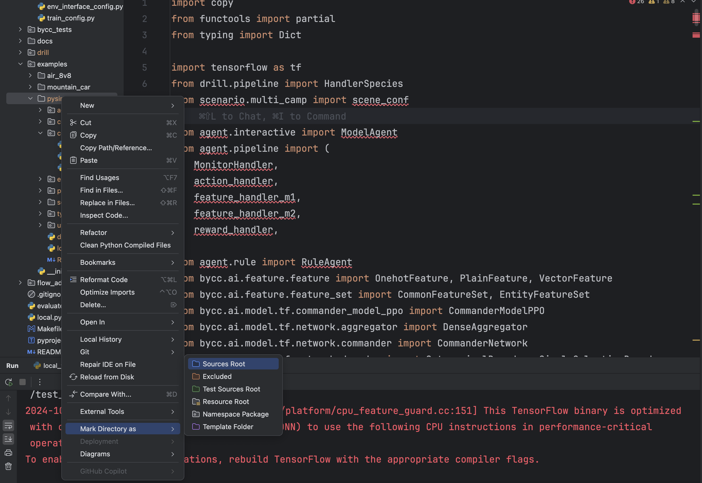

## pysim example for bycc


#### 说明

本文档和[bycc.extend Preview](https://baiyangtimes.feishu.cn/docx/F3pBdfzPSoXAfaxo3dVc4xfKnzf)互为补充。

目的将bycc推广到本地，作为一个智能体构建库，供本地开发调用。


#### 目的

构造工程例子，用来测试player-agent结构下的智能体工程，以及drill下的训练。

测试内容

+ AgentDependency模块处理agent奖励、决策间隔、输入、输出的能力
+ 对dynamic action mask的一种工程实现
+ **[todo]** agent对奖励函数，日志的处理能力
+ **[todo]**： 构造一个3层player。
  + L1为1个model agent，以大间隔（2min），决策打击风格，目标这种大类型决策，不需要和环境交互，或者本次打发（决策间隔无穷大）。
  + L2为1个rule agent，1个model agent（仅预测宾语）， 以小决策间隔（不一致），分别决策各自单位
  + L3为1个rule agent，处理L2 model agent的输出，补全mission主语，并提供规则下限。


#### 运行

整个工程可以作为独立项目，所以在执行前请将pysim_mvm添加到环境变量中PYTHONPATH 

+ 方式一

  在pycharm中对pysim_mvm右键Mark Dictionary as -> Sources Root

  

+ 方式二

  将pysim_mvm文件夹的路径添加到环境变量中
  
  ```shell
  export PYTHONPATH=/your/path/here/pysim_mvm: $PYTHONPATH
  ```


运行```local_test.py```
